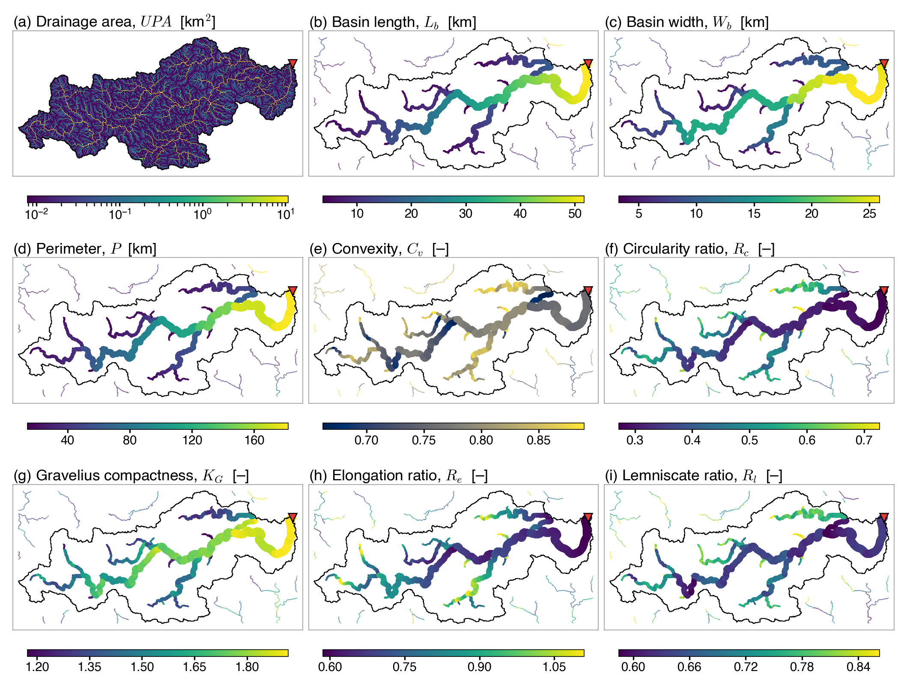
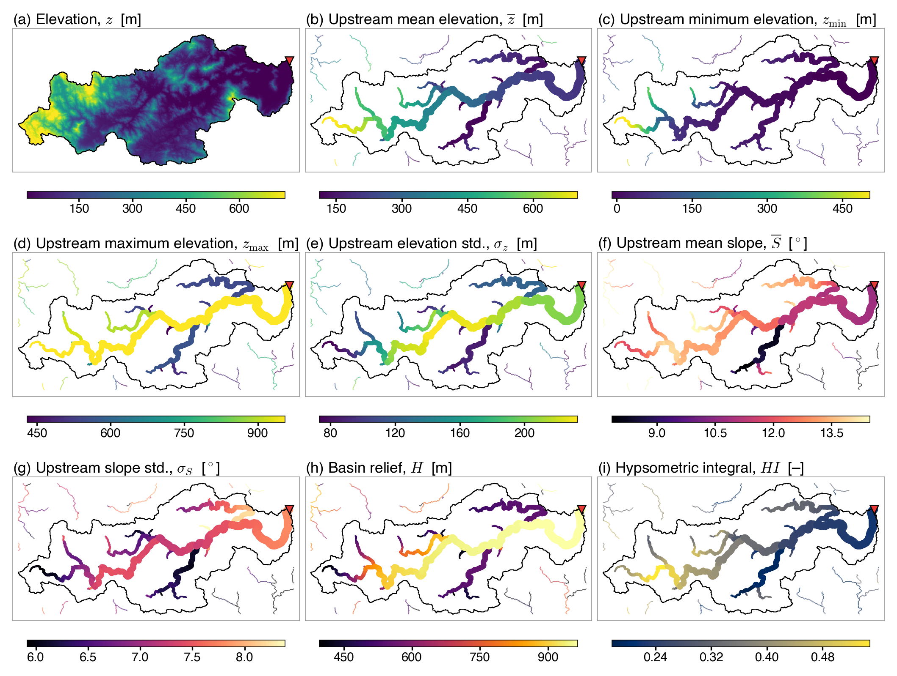
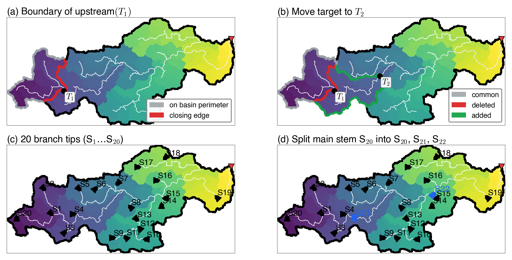

# FlowMorph

FlowMorph computes sixteen terrain and shape attributes of the catchment upstream of every pixel with at least
10 km² of drainage area on a D8 flow-direction grid.



*Drainage area (a) and the eight shape attributes (b–i) along the river network of the FullBasin paper's example
basin (Nanxi River, Fujian, China; 729 km²). Figure 9 of the FullBasin paper.*

## Install

```sh
git clone https://github.com/hellolulujiang/flowmorph.git
cd flowmorph
pip install -e .
```

Python 3.10 or later.

## Use

```python
import flowmorph

fm = flowmorph.FlowMorph.from_raster(
    "data/dir_example.tif", "data/upa_example.tif", "data/elv_example.tif")
attributes = fm.attributes()
fm.write("out")
```

Outputs contain local slope and the sixteen attributes; pixels with less than 10 km² upstream contain -9999.



*Elevation (a) and the eight terrain attributes (b–i) on the same basin. Figure 8 of the FullBasin paper.*

## How the perimeter is traced

One boundary is grown from each catchment to the next one downstream, so only the new pixels are examined.



*Figure 7 of the FullBasin paper.*

## Documentation

[User guide](docs/user-guide.md): input grids, command line, all sixteen definitions, methods and tests.

## Data products

[FullMorph v1.1](https://fullhydro.org/downloads/merit-hydro-v1.0.1-90m/fullbasin/fullmorph/v1.1/) provides the sixteen attributes across MERIT Hydro. [FullDivide regions](https://fullhydro.org/downloads/merit-hydro-v1.0.1-90m/fullbasin/fulldivide/v1.1/) · [FullHydro tools](https://fullhydro.org/tools/)

## Citing

Cite the FullBasin paper (Jiang et al., under review at *Earth System Science Data*) and this repository with the release used.

## Licence

MIT; see [LICENSE](LICENSE). The bundled MERIT Hydro and MERIT DEM excerpt and the three figures keep their own terms; see [DATA_NOTICE.md](DATA_NOTICE.md).
